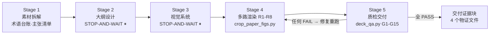

# universal-ppt-skills

[](LICENSE)
[](#实测基准8-份-deck-横评)
[](references/qa-gates.md)
[](#实测基准8-份-deck-横评)

**中文** | [English](README_EN.md)

**一个模型无关的通用 PPT 生成 Skill。** 把「AI 生成 PPT」最常见的三类翻车——**全是文字、图片来源不可信、流程不透明**——从"靠模型自觉"变成"机器判死的门禁 + 落盘的物证"。

## 效果直击（分主题 × 分模型）

同一套素材（[个人档案](docs/personal-profile.md) + iTransformer 论文 PDF）交给 4 个平台模型各生成 2 份 deck，**每份 10 页全部展示**：行 = 模型，列 = 页码，上下两表覆盖 p1–p5 / p6–p10。

### 主题一：个人信息介绍（无论文素材）

**p1–p5**

| 模型 | p1 | p2 | p3 | p4 | p5 |
| --- | --- | --- | --- | --- | --- |
| GLM-5.3-flash |  |  |  |  |  |
| DeepSeek-V4.1-Flash |  |  |  |  |  |
| Kimi-K3 |  |  |  |  |  |
| LongCat-2.5-Preview |  |  |  |  |  |

**p6–p10**

| 模型 | p6 | p7 | p8 | p9 | p10 |
| --- | --- | --- | --- | --- | --- |
| GLM-5.3-flash |  |  |  |  |  |
| DeepSeek-V4.1-Flash |  |  |  |  |  |
| Kimi-K3 |  |  |  |  |  |
| LongCat-2.5-Preview |  |  |  |  |  |

> GLM / DS / Kimi 的行里能看到图片、图表与表格页面；**LongCat 全部 10 页都是纯文字**——0 图 0 表 0 图表，视觉页占比 0%。

### 主题二：iTransformer 论文介绍（有论文原图可裁）

**p1–p5**

| 模型 | p1 | p2 | p3 | p4 | p5 |
| --- | --- | --- | --- | --- | --- |
| GLM-5.3-flash |  |  |  |  |  |
| DeepSeek-V4.1-Flash |  |  |  |  |  |
| Kimi-K3 |  |  |  |  |  |
| LongCat-2.5-Preview |  |  |  |  |  |

**p6–p10**

| 模型 | p6 | p7 | p8 | p9 | p10 |
| --- | --- | --- | --- | --- | --- |
| GLM-5.3-flash |  |  |  |  |  |
| DeepSeek-V4.1-Flash |  |  |  |  |  |
| Kimi-K3 |  |  |  |  |  |
| LongCat-2.5-Preview |  |  |  |  |  |

> 同一篇论文：DS / Kimi / GLM 的页面大量嵌入论文原图并配 in-slide citation；**LongCat 只有 2 个原生图表、0 张论文原图**——这正是 G15 要拦的情形。deck 原文件在 [example/](example/) 目录。

## 实测基准：8 份 deck 横评


| deck（平台_模型_主题） | 图片 | 原生图表 | 表格 | 视觉页占比 | 讲稿达标 | 内容质量 FAIL | 流程物证 FAIL |
| --- | ---: | ---: | ---: | ---: | :---: | :---: | :---: |
| trae_GLM-5.3-flash_个人信息介绍 | 5 | 0 | 0 | **50%** | 10/10 | 2 | 1 |
| trae_GLM-5.3-flash_iTransformer介绍 | 4 | 2 | 1 | **60%** | 10/10 | 1 | 3 |
| trae_DeepSeek-V4.1-Flash_个人信息介绍 | 5 | 2 | 0 | **70%** | 10/10 | 0 | 1 |
| trae_DeepSeek-V4.1-Flash_iTransformer介绍 | 7 | 1 | 1 | **90%** | 10/10 | 0 | 3 |
| workbuddy_Kimi-K3_个人信息介绍 | 5 | 1 | 2 | **80%** | 10/10 | 0 | 1 |
| workbuddy_Kimi-K3_iTransformer介绍 | 7 | 1 | 2 | **100%** | 10/10 | 0 | 3 |
| deepseek harness_LongCat-2.5-Preview_个人信息介绍 | 0 | 0 | 0 | **0%** | 10/10 | 3 | 1 |
| deepseek harness_LongCat-2.5-Preview_iTransformer介绍 | 0 | 2 | 1 | **30%** | 10/10 | 2 | 2 |

**复检方法**：4 份论文 deck 以 `--mode A` + 重新裁切的 `figures.json`/`paper-figures.json` 运行；4 份个人信息 deck 跑基础门禁。8 份均为早期实验产物、未走两阶段流程，故 G12（确认门）全部 FAIL，属预期并在表中单列为"流程物证"。

**关键发现**

1. **讲稿字数门禁 100% 有效**：8 份 deck 共 80 页讲稿全部落在 80–120 字（脚本逐页 `len()` 实测），说明硬门禁比"提醒模型注意"可靠得多。
2. **图文并茂差距悬殊（0% → 100%）**：有论文素材可裁的 iTransformer deck 整体视觉占比更高；而 LongCat 两个主题**一张图片都没有**，0.06–0.08 MB 的文件体积就是"全文字 deck"的直接信号。
3. **「看起来像论文图」≠「可验证」**：4 份论文 deck 共嵌入 18 张图片，与重新裁切的原图逐一比对 sha256 后 **0 张哈希一致**（缩放、重压缩、截图都会改变字节）。没有台账，G15 也无法证明论文 19 个 Figure 的取舍理由——这正是 G10/G15 要堵住的口子。
4. **内容质量零 FAIL 的组合**：DeepSeek-V4.1-Flash 与 Kimi-K3 生成的 4 份 deck 在溢出/视觉占比/连续非视觉/禁语四项上全部通过；GLM 一份 deck 命中禁语，LongCat 两份均命中视觉页不足与连续非视觉页，其个人信息 deck 另有第 6 页文字高度溢出（93.6pt vs 72.0pt）。
5. **门禁能抓住真人眼容易漏的问题**：G4 的高度溢出、G6 的"连续 3 页纯文字"、G15 的"论文有图却未交代"都是逐页肉眼很难发现的。

> 结论：**素材决定上限，门禁决定下限。** 给模型论文原图 + 硬门禁，产出质量立刻分层；反之没有物证与溯源，"图文并茂"只能靠信仰。

## 为什么需要它

直接让大模型"帮我做个 PPT"，通常会遇到三个问题：

| 顽疾 | 典型症状 | 本 skill 的对策 |
| --- | --- | --- |
| **全是文字** | 10 页有 9 页纯文字 bullet，号称"图文并茂"其实全是形状色块 | 视觉页严格定义（图片/原生图表/表格才算），G5/G6/G7 门禁判死 |
| **图片来源不可信** | 论文有现成的架构图不用，自己画一个示意版本；或贴来路不明的图 | 论文原图优先铁律 + `crop_paper_figs.py` 裁原文 + sha256 台账溯源（G10/G11） |
| **流程不透明** | 跳过大纲确认直接出片，讲稿字数凭感觉，QA 全靠一句"已完成" | 两阶段 STOP-AND-WAIT 确认门 + 脚本实测留痕 + 交付证据块模板 |

## 工作流：五阶段 + 三个检查点



规则分三级：**R0 铁律**（不可豁免）→ **G 门禁**（脚本机器判死，任何 FAIL 即返工）→ **P 偏好**（软建议，可说明理由后偏离）。

## 目录结构

```
universal-ppt-skills/
├── SKILL.md                    # 主入口：10 条铁律 + 分级 + 五阶段全流程
├── prompts/stage-prompts.md    # 两阶段 Prompt 模板（10 个模板可直接复制）
├── references/
│   ├── qa-gates.md             # G1-G15 门禁细则与机器判定方式
│   ├── render-paths.md         # R1-R8 渲染路径选型（含 12 条血泪坑）
│   ├── design-language.md      # 版式/字号/视觉规格约束
│   ├── style-library.md        # 6 大场景 30+ 风格预设
│   ├── narrative-patterns.md   # 学术/商务/教学/政务/竞赛叙事结构
│   └── delivery-template.md    # 交付证据块模板（不可豁免字段）
├── scripts/
│   ├── deck_qa.py              # 单入口门禁：G1-G15 全自动判定，FAIL→exit 1
│   └── crop_paper_figs.py      # 论文原图裁切 + figures.json 溯源台账
│                               #   + paper-figures.json 论文图片清单
├── docs/                       # 素材与基准图（论文 PDF、个人档案）
│   └── benchmark/              # 实测基准：四联对比图 + 80 页全量截图
└── example/                    # 8 份实验产物（4 模型 × 2 主题）
```

## 快速开始

1. 通读 [SKILL.md](SKILL.md) §0 的 10 条铁律（其余文档按阶段加载）；
2. 按 [prompts/stage-prompts.md](prompts/stage-prompts.md) 模板一让模型先出大纲，**确认后再继续**；
3. 渲染出片后跑门禁（论文 deck 需先裁图建立台账）：

```bash
# 论文 deck：先裁原图（同时产出论文图片清单 paper-figures.json）
python scripts/crop_paper_figs.py --pdf 论文.pdf --out work/figs --manifest work/figures.json

# 再跑单入口门禁（任何 FAIL → exit 1）
python scripts/deck_qa.py 成品.pptx \
    --spec work/deck-spec.json \
    --figures work/figures.json \
    --paper-figures work/paper-figures.json \
    --mode A --out work/qa_output.txt
```

## 门禁一览（G1–G15）

| 门禁 | 检查项 | 判定方式 |
| --- | --- | --- |
| G1 | 页数与 spec 一致 | python-pptx |
| G2 | 讲稿逐页 80–120 字 | `len()` 实测 |
| G3/G4 | 形状越界 / 文字溢出 | 几何估算 + 不可断行 token 宽度 |
| G5/G6/G7 | 视觉页占比 ≥60% / 无连续 3 页非视觉 / 视觉锚点 | 图片·原生图表·表格才算，形状色块不算 |
| G8/G9 | 占位符残留 / 中文模板化禁语 | 正则扫描 |
| G10 | 图片溯源：每张嵌入图 sha256 ↔ `figures.json`，台账文件存在且哈希自洽；学术模式仅接受 pdf-crop / docs-asset / 已留痕 self-made | 哈希 + 台账 |
| G11 | 含图页 in-slide citation（论文图标 Figure 号，自绘标「来源：自绘」） | 文本扫描 |
| G12 | 大纲/风格两阶段确认证据 | spec 字段 |
| G13 | action title（结论式标题） | 黑名单 + 位置启发 |
| G14 | 字体族收敛 / 阴影继承 | XML 遍历 |
| G15 | **论文原图使用核查**：清单里每个 Figure 要么上片、要么在 `unused_figures_reason` 给 ≥8 字理由；自绘图不得多于论文原图 | 题注扫描清单 vs 台账 |

## 已知坑（提炼自真实 deck，详见 [render-paths.md §10](references/render-paths.md)）

- 论文图**必须用脚本从 PDF 重裁**——现成图片文件无法通过 sha256 台账校验，G10 直接判"来源不可信"；
- 视觉页只认**图片 / 原生图表 / 表格**，形状拼的"示意图"不算（G5/G6/G7 会拦）；
- `Inches(float)` 与 `Inches(Emu(x))` 混用会产生 9524 英寸的巨型形状；阴影 offset 为负会**损坏文件**；
- 讲稿字数以脚本 `print` 为准，不要凭估算迭代；渲图前不要复用旧 PNG（记哈希比对）。

## License

[MIT](LICENSE)
