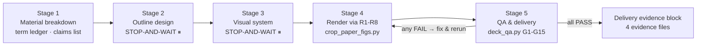

# universal-ppt-skills

[](LICENSE)
[](#benchmark-8-decks)
[](references/qa-gates.md)
[](#benchmark-8-decks)

[**中文**](README.md) | **English**

**A model-agnostic skill for generating presentation decks.** It turns the three most common failures of AI-generated PPTs — **all text, untrustworthy image sources, opaque process** — from "depends on model self-discipline" into "machine-enforced gates + on-disk evidence".

## Results at a Glance (by Topic × Model)

The same source material ([personal profile](docs/personal-profile.md) + the iTransformer paper PDF) was given to 4 platform models, each generating 2 decks. **All 10 pages of every deck are shown**: rows = models, columns = page numbers, with two stacked tables covering p1–p5 / p6–p10.

### Topic 1: Personal Profile (no paper material)

**p1–p5**

| Model | p1 | p2 | p3 | p4 | p5 |
| --- | --- | --- | --- | --- | --- |
| GLM-5.3-flash |  |  |  |  |  |
| DeepSeek-V4.1-Flash |  |  |  |  |  |
| Kimi-K3 |  |  |  |  |  |
| LongCat-2.5-Preview |  |  |  |  |  |

**p6–p10**

| Model | p6 | p7 | p8 | p9 | p10 |
| --- | --- | --- | --- | --- | --- |
| GLM-5.3-flash |  |  |  |  |  |
| DeepSeek-V4.1-Flash |  |  |  |  |  |
| Kimi-K3 |  |  |  |  |  |
| LongCat-2.5-Preview |  |  |  |  |  |

> GLM / DS / Kimi rows contain picture, chart and table pages; **all 10 pages in the LongCat row are pure text** — 0 pictures, 0 charts, 0 tables, a 0% visual-page ratio.

### Topic 2: iTransformer Paper Presentation (paper figures available)

**p1–p5**

| Model | p1 | p2 | p3 | p4 | p5 |
| --- | --- | --- | --- | --- | --- |
| GLM-5.3-flash |  |  |  |  |  |
| DeepSeek-V4.1-Flash |  |  |  |  |  |
| Kimi-K3 |  |  |  |  |  |
| LongCat-2.5-Preview |  |  |  |  |  |

**p6–p10**

| Model | p6 | p7 | p8 | p9 | p10 |
| --- | --- | --- | --- | --- | --- |
| GLM-5.3-flash |  |  |  |  |  |
| DeepSeek-V4.1-Flash |  |  |  |  |  |
| Kimi-K3 |  |  |  |  |  |
| LongCat-2.5-Preview |  |  |  |  |  |

> Same paper: DS / Kimi / GLM pages embed original paper figures with in-slide citations; **LongCat has only 2 native charts and 0 paper figures** — exactly what gate G15 is designed to catch.

## Benchmark: 8 Decks


| Deck (platform_model_topic) | Pics | Charts | Tables | Visual-page ratio | Notes OK | Content FAIL | Evidence FAIL |
| --- | ---: | ---: | ---: | ---: | :---: | :---: | :---: |
| trae_GLM-5.3-flash_personal profile | 5 | 0 | 0 | **50%** | 10/10 | 2 | 1 |
| trae_GLM-5.3-flash_iTransformer | 4 | 2 | 1 | **60%** | 10/10 | 1 | 3 |
| trae_DeepSeek-V4.1-Flash_personal profile | 5 | 2 | 0 | **70%** | 10/10 | 0 | 1 |
| trae_DeepSeek-V4.1-Flash_iTransformer | 7 | 1 | 1 | **90%** | 10/10 | 0 | 3 |
| workbuddy_Kimi-K3_personal profile | 5 | 1 | 2 | **80%** | 10/10 | 0 | 1 |
| workbuddy_Kimi-K3_iTransformer | 7 | 1 | 2 | **100%** | 10/10 | 0 | 3 |
| deepseek harness_LongCat-2.5-Preview_personal profile | 0 | 0 | 0 | **0%** | 10/10 | 3 | 1 |
| deepseek harness_LongCat-2.5-Preview_iTransformer | 0 | 2 | 1 | **30%** | 10/10 | 2 | 2 |

**Recheck method**: the 4 paper decks ran with `--mode A` plus freshly re-cropped `figures.json`/`paper-figures.json`; the 4 profile decks ran base gates. All 8 decks are early-stage experiments that skipped the two-phase flow, so G12 (confirmation gate) fails across the board — expected, and reported separately as "evidence" failures.

**Key findings**

1. **The notes-length gate is 100% effective**: all 80 pages' speaker notes fall in the 80–120 character range (measured per page via `len()`). Hard gates beat gentle reminders.
2. **Huge gap in visual richness (0% → 100%)**: iTransformer decks with croppable paper figures score higher overall; LongCat's two decks contain **not a single image**, and their 0.06–0.08 MB file size is the direct signature of an all-text deck.
3. **"Looks like a paper figure" ≠ "verifiable"**: the 4 paper decks embed 18 images in total; after sha256 comparison against freshly cropped originals, **0 match** (scaling, recompression and screenshots all change bytes). Without a ledger, G15 cannot prove how the paper's 19 figures were disposed — exactly the hole G10/G15 plug.
4. **Zero content-quality FAILs**: the 4 decks by DeepSeek-V4.1-Flash and Kimi-K3 pass overflow / visual ratio / consecutive non-visual / banned-phrase checks; one GLM deck hits a banned phrase, and both LongCat decks fail visual-ratio and consecutive-non-visual gates, with a text overflow on page 6 of its profile deck (93.6pt vs 72.0pt).
5. **Gates catch what human eyes miss**: G4's height overflow, G6's "3 consecutive text pages" and G15's "paper figure never accounted for" are hard to spot page by page.

> Bottom line: **material sets the ceiling, gates set the floor.** Give a model original paper figures plus hard gates and quality stratifies immediately; without evidence and provenance, "rich visuals" is a matter of faith.

## Why It Exists

Asking an LLM to "make me a PPT" usually hits three problems:

| Problem | Typical symptom | This skill's answer |
| --- | --- | --- |
| **All text** | 9 of 10 pages are text bullets; "rich visuals" that are really just colored shapes | Strict visual-page definition (only pictures / native charts / tables count); gates G5/G6/G7 |
| **Untrustworthy images** | Ignores the paper's ready-made architecture figure and draws its own; or pastes images of unknown origin | Paper-figure-first iron rule + `crop_paper_figs.py` crops from the PDF + sha256 ledger provenance (G10/G11) |
| **Opaque process** | Skips outline confirmation, notes length by gut feeling, QA summarized as "done" | Two-phase STOP-AND-WAIT gates + script-measured evidence + delivery evidence template |

## Workflow: Five Stages + Three Checkpoints



Rules are tiered: **R0 iron rules** (never waivable) → **G gates** (machine-enforced, any FAIL = rework) → **P preferences** (soft, may deviate with a stated reason).

## Repository Layout

```
universal-ppt-skills/
├── SKILL.md                    # Main entry: 10 iron rules + tiers + five-stage flow
├── prompts/stage-prompts.md    # Two-phase prompt templates (10 ready-to-copy)
├── references/
│   ├── qa-gates.md             # G1-G15 gate details & machine checks
│   ├── render-paths.md         # R1-R8 rendering paths (12 hard-won pitfalls)
│   ├── design-language.md      # Layout / typography / visual specs
│   ├── style-library.md        # 30+ style presets across 6 scenarios
│   ├── narrative-patterns.md   # Academic / business / teaching / gov / contest narratives
│   └── delivery-template.md    # Delivery evidence block template (non-waivable)
├── scripts/
│   ├── deck_qa.py              # Single-entry gate: G1-G15, any FAIL → exit 1
│   └── crop_paper_figs.py      # Paper figure cropping + figures.json ledger
│                               #   + paper-figures.json inventory of the paper
├── docs/                       # Source material & benchmark assets
│   └── benchmark/              # Benchmark: overview chart + all 80 slide captures
└── example/                    # 8 experiment decks (4 models × 2 topics)
```

## Quick Start

1. Read the 10 iron rules in [SKILL.md](SKILL.md) §0 (other docs load per stage);
2. Use template 1 in [prompts/stage-prompts.md](prompts/stage-prompts.md) to get an outline first — **confirm before continuing**;
3. After rendering, run the gates (paper decks must build a figure ledger first):

```bash
# Paper decks: crop original figures first (also emits the paper figure inventory)
python scripts/crop_paper_figs.py --pdf paper.pdf --out work/figs --manifest work/figures.json

# Then run the single-entry gate (any FAIL → exit 1)
python scripts/deck_qa.py deck.pptx \
    --spec work/deck-spec.json \
    --figures work/figures.json \
    --paper-figures work/paper-figures.json \
    --mode A --out work/qa_output.txt
```

## Gates at a Glance (G1–G15)

| Gate | Checks | Method |
| --- | --- | --- |
| G1 | Page count matches spec | python-pptx |
| G2 | Notes 80–120 chars per page | measured `len()` |
| G3/G4 | Shape out-of-bounds / text overflow | geometry estimate + unbreakable-token width |
| G5/G6/G7 | Visual-page ratio ≥60% / no 3 consecutive non-visual pages / visual anchors | only pictures · native charts · tables count; colored shapes don't |
| G8/G9 | Placeholder leftovers / templated Chinese phrases | regex scan |
| G10 | Image provenance: every embedded image's sha256 ↔ `figures.json`; ledger file exists & hash-consistent; academic mode accepts only pdf-crop / docs-asset / documented self-made | hash + ledger |
| G11 | In-slide citation on picture pages (paper figures cite the Figure number; self-made marked "self-drawn") | text scan |
| G12 | Outline/style two-phase confirmation evidence | spec fields |
| G13 | Action titles (conclusion-style) | blacklist + position heuristics |
| G14 | Font-family convergence / shadow inheritance | XML traversal |
| G15 | **Paper-figure usage audit**: every Figure in the inventory is either in the deck or excused via `unused_figures_reason` (≥8 chars); self-made images must not outnumber paper figures | caption inventory vs ledger |

## Known Pitfalls (distilled from real decks, see [render-paths.md §10](references/render-paths.md))

- Paper figures **must be re-cropped from the PDF by script** — pre-existing image files cannot pass the sha256 ledger check; G10 flags them as untrusted;
- Visual pages count only **pictures / native charts / tables** — shape-assembled "diagrams" don't qualify (G5/G6/G7 catch this);
- Mixing `Inches(float)` with `Inches(Emu(x))` creates 9524-inch giant shapes; negative shadow offsets **corrupt the file**;
- Iterate notes length against script `print` output, not estimates; never reuse stale PNGs after edits (compare hashes).

## License

[MIT](LICENSE)
